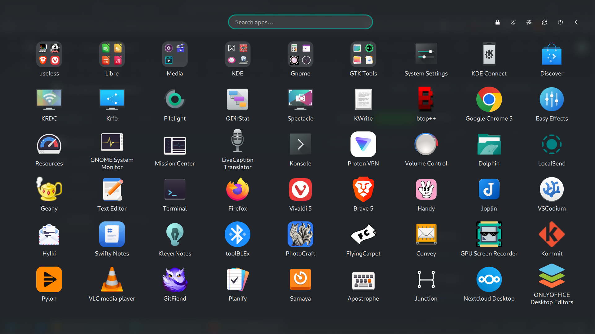
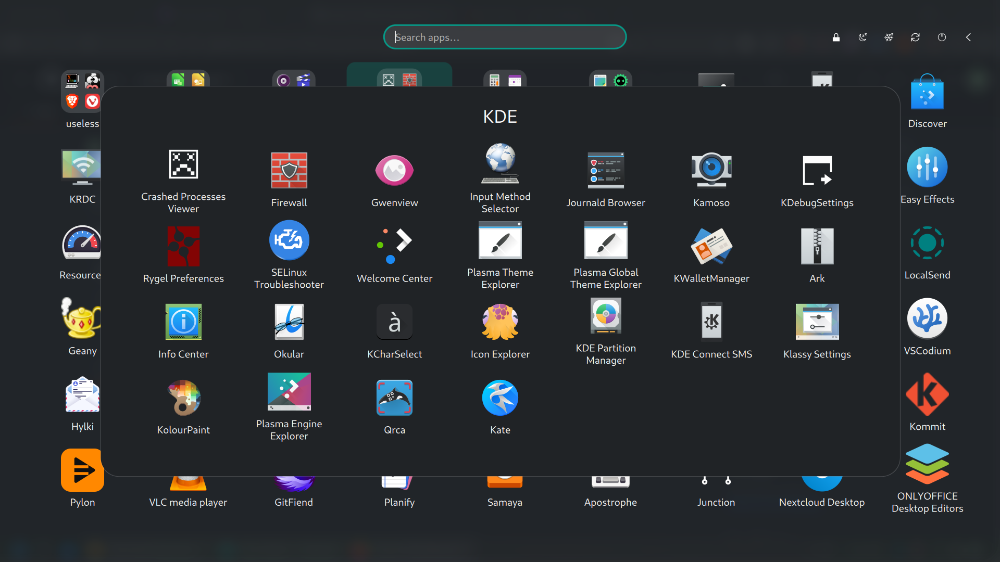

# App Grid Launcher

A fullscreen application launcher for KDE Plasma 6, inspired by the GNOME app
grid. Browse every installed application in a clean, scalable grid, search as
you type, and organise apps into groups without touching the system
application menu.



## Features

- **Fullscreen app grid** that scales to your screen, icon size and spacing.
- **Instant search** across all installed applications.
- **Custom groups** with a 2×2 icon preview, rename and ungroup actions.
- **Per-widget layout** — reorder apps, create groups, and hide apps. Your
  changes are stored only in this widget's configuration; the system
  application menu is never modified.
- **Two colour themes** — follow the current Plasma colour scheme, or use a
  dark GNOME-style look.
- **Custom colours** for the backdrop, popups, text and accent.
- **Size and spacing controls**, with automatic modes that follow your system
  scaling and screen width.
- **Power actions** in the search bar: lock, sleep, hibernate, restart, shut
  down and log out (each can be disabled).
- **Keyboard navigation** — arrow keys, Tab, Enter and the Menu key.
- **Backup and restore** of the launcher's layout, groups, hidden apps and
  appearance settings as JSON.
- **Configurable panel icon**, including custom image support.

## Screenshots




## Requirements

- KDE Plasma **6.0** or newer
- KDE Frameworks 6
- `kpackagetool6` (part of `kpackage`)

## Installation

### From a release (recommended)

1. Download `org.plasma.appgrid-<version>.plasmoid` from the
   [Releases](https://github.com/butter-fly04/org.plasma.appgrid/releases) page.
2. Install it with one of these methods:
   - **Plasma:** right-click the panel or desktop, enter **Edit Mode**, choose
     **Add Widgets → Get New Widgets → Install Widget from Local File…**, and
     select the downloaded file.
   - **Command line:**

     ```bash
     kpackagetool6 --type Plasma/Applet --install org.plasma.appgrid-<version>.plasmoid
     ```

3. Add **App Grid Launcher** from the widget picker.

To update an existing installation from a newer `.plasmoid` file:

```bash
kpackagetool6 --type Plasma/Applet --upgrade org.plasma.appgrid-<version>.plasmoid
```

### From source

```bash
git clone https://github.com/butter-fly04/org.plasma.appgrid.git
cd org.plasma.appgrid
make install
```

Use `make upgrade` to reinstall after editing the source, and
`make uninstall` to remove the widget.

## Usage

- Click the panel icon (or use the widget's global shortcut, if configured) to
  open the launcher.
- Start typing to search; press **Enter** to launch the first result.
- Click a group tile to open it.
- **Right-click** any app or group for actions such as *Move earlier*,
  *Move later*, *New group with this app…*, *Add to group*, *Rename group…* and
  *Ungroup*.
- Open the widget's settings to:
  - reorder apps and groups, create groups, or hide apps (**Layout**);
  - choose the theme, icon size, spacing and colours (**Appearance**);
  - choose the panel icon, power buttons and animation behaviour (**General**);
  - export or import the launcher's settings (**Backup**).

## Building the package

```bash
make package
```

The installable archive is written to
`dist/org.plasma.appgrid-<version>.plasmoid`.

## Project layout

```text
.
├── org.plasma.appgrid/      # Plasma applet package
│   ├── contents/
│   │   ├── config/          # KConfigXT definitions and settings pages
│   │   └── ui/              # QML interface
│   └── metadata.json
├── screenshots/
├── Makefile
├── CHANGELOG.md
└── LICENSE
```

## License

This project is licensed under the GNU General Public License v3.0 or later.
See [LICENSE](LICENSE) for the full text.
